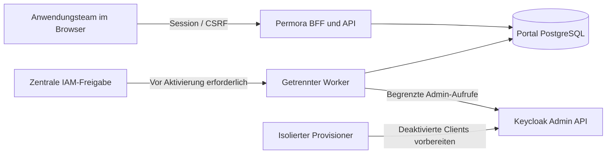

<p align="center"></p>

# Permora

**Sprache:** [English](README.md) · **Deutsch**

[](https://github.com/Cenn0/Permora/actions/workflows/ci.yml)
[](LICENSE)

**Direkt zu:** [Funktionsumfang](#was-permora-abdeckt) · [Vertrauensgrenzen](#vertrauensgrenzen) · [Lokale Entwicklung](#lokale-entwicklungsumgebung) · [Dokumentation](docs/README.md) · [Roadmap](docs/roadmap.md)

**Anwendungen und Berechtigungen in Keycloak gezielt an Teams delegieren.**

Permora ist ein eigenständiges, quelloffenes **C#-/Angular-Portal** für die eingeschränkte Verwaltung eigener Anwendungen. Anwendungsteams können fachliche Rollen, Einzelberechtigungen und Zugriffsanträge bearbeiten, ohne die zentrale Realm-Verwaltung zu erhalten.

> **Status: technisch in CI geprüft, nicht produktionsfreigegeben.** Der dokumentierte GitHub-Actions-Abnahmelauf hat sieben Pflichtjobs bestanden: .NET-/Angular-Builds, 102 xUnit-Tests einschließlich PostgreSQL, 32 Frontend-Logiktests, 8 Playwright-Tests, ausgewählte FGAP-Berechtigungstests mit echtem Keycloak 26.8.1 und ein lokaler Docker-Build. **Produktives OIDC/MFA, LDAP/AD, vollständige Berechtigungsmatrix, Wiederanlauf- und Penetrationstests sind weiterhin offen.** Siehe [CI-Nachweise](docs/ci.md) und [Roadmap](docs/roadmap.md).

## Was Permora abdeckt

- **Anwendungen und Teams:** Anwendungskatalog, Registrierung, Owner-, Maintainer-, AccessManager-, Approver- und Auditor-Mandate.
- **Berechtigungen:** Anwendungsbezogene `perm.*`-Einzelrechte und zusammengesetzte `role.*`-Rollen; Benutzer- und Gruppenzuweisungen.
- **Governance:** Vier-Augen-Freigaben, Funktionstrennung (SoD), Ablaufdaten, Rezertifizierung und anwendungsbezogenes Änderungsprotokoll.
- **Provisionierung:** Persistente Änderungsaufträge, Wiederholungen, Soll-/Ist-Abgleich und Rückprüfung tatsächlicher Keycloak-Zuweisungen.
- **Oberfläche:** Responsives Angular-Dashboard mit Anwendungskarten, Aufgaben und Aktivitäten.

Die wesentliche Sicherheitsgrenze bleibt **zentral**: Realm-Einstellungen, übergreifende Berechtigungen, IAM-Sicherheitsrichtlinien und die Freigabe neuer Clients/Delegationsrechte gehören nicht zum Self-Service. Neu vorbereitete Clients bleiben bis zur dokumentierten IAM-Abnahme deaktiviert. Eine API-Antwort `202 Accepted` bedeutet **nicht**, dass eine Änderung bereits in Keycloak wirksam ist.

**Noch nicht umgesetzt oder abgenommen** sind insbesondere automatisiertes FGAP-Provisioning, vollständige externe Identitätskorrelation, ABAC, vollständige HR-/AD-Konnektoren, externe unveränderliche Audit-Speicherung sowie Last-, Wiederanlauf- und Penetrationstests. Die [Roadmap](docs/roadmap.md) unterscheidet Quellcode, ausgeführte Tests und offene Abnahmekriterien.

## Vertrauensgrenzen



Dies beschreibt eine **Architekturgrenze**, keine nachgewiesene produktive Berechtigungsisolation. Client-Aktivierung erfordert eine zentrale IAM-Freigabe; angenommene Änderungsaufträge müssen mit Keycloak abgeglichen werden. [Architektur](docs/architecture.md), [Sicherheitsmodell](docs/security.md) und [CI-Nachweise](docs/ci.md) trennen Funktion, Herstellersupport und Sicherheitsabnahme.

## Technische Basis

| Komponente | Technologie |
| --- | --- |
| Backend und Worker | C# / .NET 10 (ASP.NET Core) |
| Frontend | Angular 22 / TypeScript |
| Datenbank | PostgreSQL |
| Identity Provider | Keycloak (Zielversion und FGAP-Verhalten versionsgebunden prüfen) |
| Authentifizierung | OIDC-Backend-for-Frontend mit serverseitiger Session; getrennte Connector-Berechtigungen |
| Lizenz | [Apache-2.0](LICENSE) |

Permora ist **keine offizielle Keycloak-Komponente**. Die technische Nutzbarkeit einer Schnittstelle bedeutet weder Hersteller-Support noch eine abgeschlossene Sicherheitsprüfung.

## Lokale Entwicklungsumgebung

Benötigt werden die SDK-Version aus [global.json](global.json), eine zu Angular 22 passende Node.js-Version, Python 3 und Docker Compose. Die folgenden Befehle verwenden Bash und starten **nur eine lokale Entwicklungsumgebung**:

```bash
python3 scripts/init-local.py
docker compose --env-file deploy/local.env -f deploy/compose.local.yml up -d --wait

export PERMORA_CONFIG="$PWD/config/local.json"
export DOTNET_ENVIRONMENT=Development
export ASPNETCORE_ENVIRONMENT=Development

dotnet run --project src/Permora.Worker -- --migrate
dotnet run --project src/Permora.Worker -- --seed-demo
```

Anschließend API und Worker in **getrennten Terminals** vom Repository-Verzeichnis starten; dabei dieselben drei Umgebungsvariablen setzen:

```bash
ASPNETCORE_URLS=http://127.0.0.1:5080 dotnet run --project src/Permora.Api
# In einem weiteren Terminal:
dotnet run --project src/Permora.Worker
```

Frontend in einem dritten Terminal:

```bash
cd web
npm ci
npm start
```

Die Oberfläche ist unter **http://localhost:4200** erreichbar. Der lokale `demo-owner`-Zugang ist ausdrücklich **nur für Development**, kein produktives Single Sign-on. Der Keycloak-Entwicklungscontainer konfiguriert noch keine produktiven Realm-/FGAP-Rechte; dafür ist eine separate [IAM-Anbindung](docs/keycloak.md) nötig.

## Tests und Freigabestatus

```bash
bash scripts/check.sh --lightweight
bash scripts/check.sh
```

`--lightweight` prüft Repository-Struktur und isolierte Frontend-Logik. Die Paket-Lockfiles sind inzwischen eingecheckt und werden in der CI validiert. Der vollständige lokale Lauf benötigt zusätzlich passende SDKs sowie eine **isolierte** PostgreSQL-Testdatenbank über `PERMORA_TEST_POSTGRES`. Die [GitHub-Actions-CI](.github/workflows/ci.yml) testet gesperrte Restores, .NET/Angular, ausgewählte echte Keycloak-FGAP-Fälle und den Docker-Build **ohne Veröffentlichung oder Deployment**. Das ersetzt keine Produktionsabnahme.

[Entwicklungsanleitung](docs/development.md) · [CI-Abdeckung](docs/ci.md) · [Testvoraussetzungen](docs/testing.md) · [Prüfergebnisse](docs/review.md)

## Dokumentation und Mitarbeit

[Dokumentationsindex](docs/README.md) · [Architektur](docs/architecture.md) · [Keycloak und Delegation](docs/keycloak.md) · [Sicherheit](docs/security.md) · [Betrieb](docs/operations.md) · [Roadmap](docs/roadmap.md) · [API](docs/api.md) · [Contributing](CONTRIBUTING.md) · [Security Policy](SECURITY.md)

Veröffentlicht unter der [Apache License 2.0](LICENSE). Sicherheitslücken bitte über den in [SECURITY.md](SECURITY.md) beschriebenen privaten Meldeweg melden, nicht mit Zugangsdaten oder internen Systeminformationen in öffentlichen Issues.
