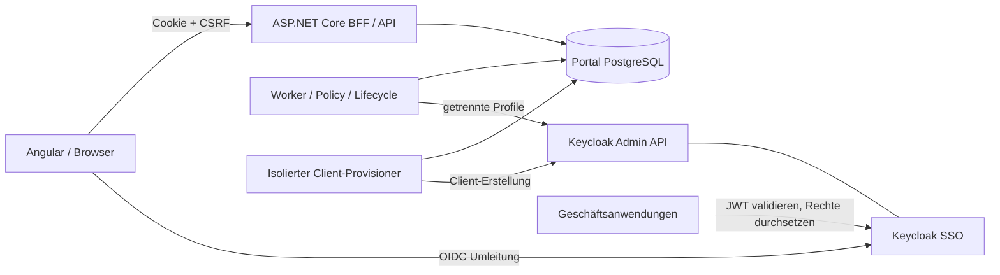

# Architektur

## Systemgrenzen

Das Portal ist keine durchreichende Admin-Konsole. Es akzeptiert ausschließlich typisierte fachliche Befehle. Browser besitzen weder Admin-API-Service-Tokens noch Refresh Tokens. Endanwender erhalten durch ein Verwaltungsmandat keine `realm-management`-Rolle.

`Permora.Core` enthält unveränderliche Domänenobjekte, Policy, Änderungsaufträge und Lifecycle. `Infrastructure` implementiert PostgreSQL, Sessions und Keycloak. `Api` stellt BFF und REST bereit. `Worker` führt bestätigte Aufträge aus und synchronisiert das Verzeichnis. `Provisioner` ist ein eigener Prozess mit eigenen Geheimnissen; er kann deaktivierte Clients vorbereiten, aber keine beliebigen Benutzerbefehle ausführen. `Authorization` ist ein kleines ASP.NET-Core-SDK für das **fachliche** Berechtigungsmodell.

## Anwendung und Eigentum

Eine Anwendung gehört genau einem Team; jedes Team kann mehrere Anwendungen haben. Pro Anwendung wird ein Rechte-Client und optional ein Login-Client gebunden. Interne Client-UUID und menschenlesbare Client-ID werden getrennt gespeichert. `permora.application` und `permora.entity` markieren zugehörige Keycloak-Ressourcen. Marker sind Integritätskontrollen, keine magischen Keycloak-Zugriffsregeln.

Alle Rollenverknüpfungen bleiben innerhalb einer Anwendung. `role.supervisor` kann `perm.orders.read` und `perm.orders.approve` enthalten, nicht fremde Client-Rollen, Realm-Rollen oder andere Rollenbündel. Das flache Modell verhindert verschachtelte Zyklen durch die Datenstruktur. Ein neues Recht wird standardmäßig als High-Risk behandelt. Nur zentrale IAM-Administratoren dürfen es niedriger einstufen.

Die aktuelle Worker-Konfiguration erlaubt nur denselben Identity-Issuer wie die Portal-Anmeldung. Die Identität ist `SHA256(JSON([issuer, sub]))`, kein Name und keine E-Mail. Ein `RealmKey` macht das Schema erweiterbar, ist aber **kein** Nachweis implementierter mandantenübergreifender Personenkorrelation.

## Datenhoheit und Konsistenz

PostgreSQL hält Verantwortlichkeiten, fachliche Metadaten, beantragte Änderungen, genehmigte Sollzustände, Directory-Snapshots und Audit. Keycloak hält tatsächlich wirksame Rollen/Zuweisungen. Die Anwendungsprojektion wird erst nach erfolgreicher Remote-Rückprüfung aktualisiert. Bei Drift ist die gespeicherte Projektion nicht als uneingeschränkt aktueller Keycloak-Bestand zu verstehen.

Ein Auftrag bildet zugleich die transaktionale Outbox. Es gibt keine zusätzliche Broker-Pflicht und keine vermeintliche atomare Transaktion über PostgreSQL und Keycloak. API-Annahme, Genehmigung, Remote-Anwendung und lokaler Abschluss sind verschiedene Zustände. `Applying` ist als Enum reserviert, derzeit aber nicht als separat dauerhafter Zwischenzustand gespeichert.

Der Worker hält pro Anwendung einen PostgreSQL-Zeilenlock während des begrenzten Remote-Aufrufs. Zwei Worker serialisieren dieselbe Anwendung; verschiedene Anwendungen können unabhängig verarbeitet werden. Der Rollback einer Datenbanktransaktion rollt eine bereits erfolgte Keycloak-Änderung **nicht** zurück. Idempotente Aufträge, Ownership-Prüfung, Read-after-write, Backoff und ein Blockierzustand für unklare Änderungen begrenzen dieses Risiko.

Sechs erfolglose Remote-Versuche führen zu `Failed`. Danach blockieren nicht geklärte schreibende Aufträge weitere Rechteerweiterungen. Ein sauberer Abgleich mit dem gespeicherten Zustand kann solche Aufträge als `Rejected/reconciled_not_applied` abschließen; er behauptet nicht nachträglich eine erfolgreiche Vergabe. Änderungen mit abweichender Revision werden nicht blind erneut ausgeführt. Entzüge werden priorisiert und sind kein Rollback zu potenziell höheren Rechten.

## ADR-001: Modularer Monolith statt Microservices

Fachlogik und Datenmodell bilden zunächst eine Deployment-Einheit mit separat gestarteten API/Worker-Prozessen. Nur der höher privilegierte Provisioner ist eine bewusste zusätzliche Vertrauensgrenze. Vorteil: weniger verteilte Transaktionen und Betriebsaufwand. Nachteil: gemeinsame Datenbank, gemeinsame Release-Koordination und noch nicht unabhängig skalierbare Domänen.

## ADR-002: Npgsql und JSONB-Aggregate statt EF Core

Die erste Implementierung verwendet direkte parametrisierte Npgsql-Zugriffe. Anwendungen werden als versionierte JSONB-Aggregate mit relationalen Such-/Ownership-Spalten gespeichert. Das hält Rollen, Permissions und Zuweisungen im selben schreibgeschützten Kontext einer App und vereinfacht nachvollziehbare Sperren. Es weicht bewusst vom ursprünglichen EF-Core-Vorschlag ab.

Grenzen: Große Aggregate werden vollständig gelesen/geschrieben, JSON-Versionierung muss gepflegt werden, teamübergreifende Berichte sind nicht optimiert. Die Schutzlimits von 2.000 Rollen, 2.000 Permissions und 10.000 Zuweisungen sind keine zugesagten Leistungswerte. Vor großem Enterprise-Einsatz Lasttests durchführen und gegebenenfalls normalisieren. Migrationen sind explizit; die API führt sie nicht automatisch aus.

## ADR-003: Rollenmodell vor Authorization Services

Einzelrechte sind Client-Rollen. OIDC-Scopes, Keycloak-Authorization-Services-Scopes und diese Einzelrechte sind verschiedene Begriffe. Objekt- und kontextbezogenes ABAC sowie UMA sind nicht implementiert. Die Oberfläche nennt Einzelrechte daher nicht pauschal „Scopes“.

## ADR-004: Zentraler Aktivierungsschritt

Die Client-Erstellung bereitet einen deaktivierten, restriktiven Rechte-Client vor. FGAP, Zielbenutzersicht, Audience und optionale Login-Client-Konfiguration werden separat abgenommen. Erst ein sauberer Abgleich kann die Portal-Anwendung aktivieren. Es wird kein erfundenes, versionsunabhängig sicheres FGAP-JSON ausgerollt.
