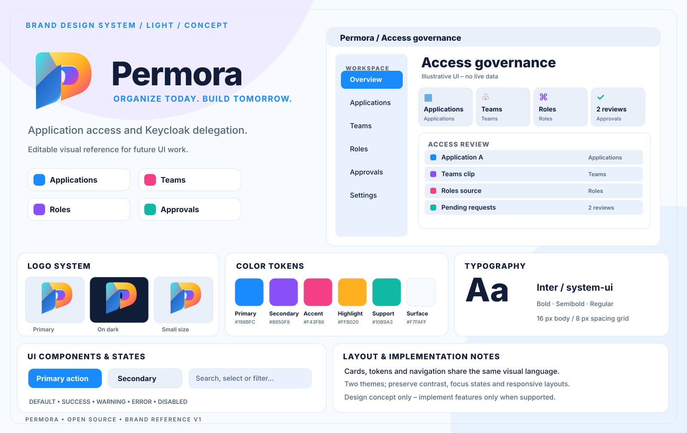
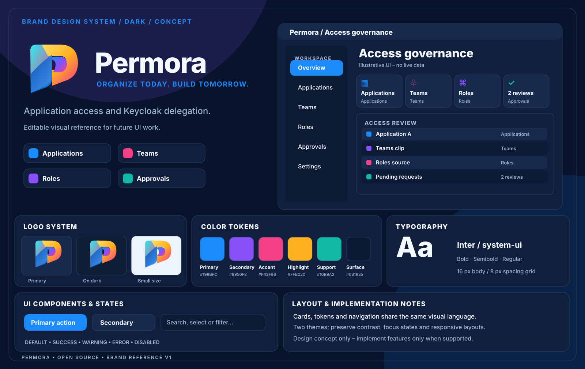

# Permora brand identity and UI concepts

**Design reference, not a product screenshot or an implementation claim.**

The self-contained SVG assets are versioned for later UI design. [Brand logo](logo.svg) and both full-sized concept boards are editable without external scripts or fonts.

| Token | HEX |
| --- | --- |
| Primary | `#198BFC` |
| Secondary | `#8950F8` |
| Accent | `#F43F86` |
| Highlight | `#FFB020` |
| Support | `#10B9A3` |
| Light surface | `#F7FAFF` |
| Dark surface | `#0C1A35` |

Use Inter with system font fallbacks and an 8 px spacing grid. Implement semantic tokens, focus indicators, responsive layouts, accessible contrast and localization. The illustrated dashboard is aspirational; consult the project's README, roadmap and security documentation for actual capabilities. Never put personal contact information, production data or credentials in public design assets.

**No trademark clearance is claimed.** Visually distinctive designs still need separate professional trademark research before exclusive brand claims.
